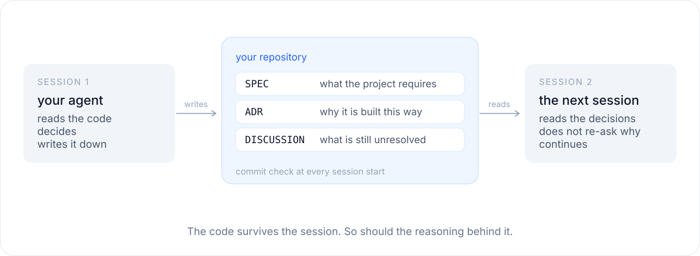

# sddio

**Your agent forgets. Your repo doesn't.**

[English](README.md) · [简体中文](README.zh-CN.md)

[](https://github.com/benxgao/sddio/actions/workflows/ci.yml)


sddio is **spec-driven development for coding agents**, kept in git: `SPEC` (what the project requires), `ADR` (why it is built this way), `DISCUSSION` (what is still unresolved), `FLOW` (what is being worked on). Because the judgement sits next to the code, it survives session restarts, shows up in pull requests, and works with any agent — or with none.

`v0.1.0` · Node ≥ 18 · MIT · no account, no telemetry, no service

## Quick start

```bash
npm install --save-dev @sddio/cli
npx sddio init
```

**1 install → 2 paste → 3 commit.** `init` writes the scaffold and ends by printing one prompt. Paste it into your agent — the files alone do nothing.

<details>
<summary><b>Paste this into your coding agent</b></summary>

```text
────────────────────────────────────────────────────────────────
Paste this into your coding agent
────────────────────────────────────────────────────────────────

Read `.sddio/context/instructions.md` and follow it.

This project has just been initialised with sddio. Before any other work:

1. Run the commit check in `.sddio/context/instructions/reconciliation.md`.
   `config.json` has no baseline yet, so the state is `unknown`.
2. Bootstrap the workspace as described in `instructions/bootstrap.md`:
   derive the minimum SPEC from the existing code, configuration, tests and
   documentation. Do not ask me for facts the repository already contains.
3. Record at least one DISCUSSION for what the repository cannot settle, so
   the workspace opens with an open question and not only with claims.
4. Report what you recorded, then set `lastProcessedCommit` to `HEAD` and
   `previousCommit` to `HEAD^` in `.sddio/context/config.json`
   (`null` at a root commit).

Then answer this: <your first task>
```

</details>

Then commit `.sddio/` and `sddio_workspace/` with your next change.



> **Already using sddio?** [Upgrade](#upgrading) · [Copy a prompt](#copy-blocks) · [Layout](#layout) · [Releases](https://github.com/benxgao/sddio/releases)

## What lands in your repository

```text
.sddio/                  # context layer, owned by the CLI — replaced on upgrade
sddio_workspace/         # your project's knowledge, owned by you and your agent
  spec/  adr/  discussions/  flow/
AGENTS.md                # sddio snippet appended; existing content preserved
```

`init` writes nothing outside the project, never touches an agent configuration directory, and performs no git action. Committing the two directories is the only step it leaves to you.

## This repository runs on sddio

Not a demo directory: the requirements, trade-offs and open questions behind this CLI are in the same layout you would get.

- [`SPEC-011`](sddio_workspace/spec/spec_100.md) — `init` ends with the agent's next step, not with a file list
- [`ADR-005`](sddio_workspace/adr/adr_100.md) — why the shipped context is a build artefact, including the approach that was rejected
- [`DISC-023`](sddio_workspace/discussions/discussions_100.md) — a 0-byte `package.json` that made every `npm` command fail

Each of these settled a decision once. None of them is re-derivable from the code — which is the point.

## Where the knowledge lives

|                             | Chat history | A docs folder          | sddio                                   |
| --------------------------- | ------------ | ---------------------- | --------------------------------------- |
| Survives a new session      | no           | yes                    | yes                                     |
| Updated when the code moves | no           | when someone remembers | checked against `HEAD` at session start |
| Reviewable before it lands  | no           | yes                    | yes — it is a diff                      |
| Records what is still open  | no           | rarely                 | a first-class entry (`DISCUSSION`)      |
| Tied to one agent           | yes          | no                     | no                                      |

## What it does not do

- It does not write code. It records the decisions your agent would otherwise re-derive from scratch.
- It does not search or index. Entries are plain Markdown; `grep` is the query language.
- It does not enforce anything by itself. A rule is only as strong as the agent that reads it, until a check makes it fail.

## For teams

One person runs `init` and commits the result. From then on, every pull request that changes a requirement or a trade-off carries that change as a diff, so a reviewer can object to the reasoning and not only to the code. The next laptop starts from the same file.

Nothing to provision: no account, no server, no telemetry, one devDependency, MIT.

## Upgrading

```bash
npm install --save-dev @sddio/cli@latest
npx sddio init
```

`.sddio/` is replaced; `sddio_workspace/` is never touched. **An upgrade resets the reconciliation cursor to `null`**, so the next session has no baseline: paste the reconcile prompt `init` prints and let the agent verify the existing entries once. Skip it and the workspace stays `unknown`, re-checking from scratch on every session.

## Copy blocks

The two prompts `init` can print, for pasting later. They must stay in sync with `lib/prompt.ts`, which `test/prompt.test.mjs` asserts.

<details>
<summary><b>Reconcile after an upgrade</b></summary>

```text
Read `.sddio/context/instructions.md` and follow it.

The sddio context layer in `.sddio/` was just refreshed by a package upgrade,
and `config.json` now carries no baseline (`null`). Before any other work, run
the commit check and reconcile: `.sddio/context/instructions/reconciliation.md`.

The cursor state is `unknown`, so there is no range to diff: verify the existing
artifacts against the current implementation. Do not rescan unrelated areas, and
do not rewrite artifacts that are still accurate.

Report what you understood and what you changed, then set `lastProcessedCommit`
to `HEAD` and `previousCommit` to `HEAD^` in `.sddio/context/config.json`
(`null` at a root commit), so the next session resumes from a baseline.

Then answer this: <your first task>
```

</details>

## Layout

| Path               | Owner              | Rule                                                                                                  |
| ------------------ | ------------------ | ----------------------------------------------------------------------------------------------------- |
| `.sddio/`          | the CLI            | context layer: instructions, schema, routes. Refreshed on `init`, so upgrades carry the current layer |
| `sddio_workspace/` | you and your agent | `spec/`, `adr/`, `discussions/`, `flow/`. Never overwritten                                           |

Every session starts with a commit check: the cursor in `.sddio/context/config.json` is compared with `HEAD`, and only the range that moved is reconciled. See `.sddio/context/instructions/reconciliation.md`.

## Agent skill

Agents that support skills can be handed a short router instead of being pointed at `AGENTS.md`: `npx sddio skill --print` emits it on stdout and writes nothing. The file also ships inside the project at `.sddio/skill/SKILL.md`, so it can be copied by hand. See [`packages/cli/README.md`](packages/cli/README.md#agent-skill).

## For agents

If a human hands you this repository:

- Entry point: `.sddio/context/instructions.md`. `AGENTS.md` is the canonical registration and is not a second source of rules.
- Do not edit `.sddio/`; it is package-owned. Project knowledge lives in `sddio_workspace/`.
- `grep -rn "^## " sddio_workspace/*/` lists every entry. Read about 25 lines around a hit instead of reading the file.
- Every session begins with the commit check in `.sddio/context/instructions/reconciliation.md`, before any other work.

## Documentation

- [`packages/cli/README.md`](packages/cli/README.md) — commands, flags, what lands in a project
- [`packages/cli/TESTING.md`](packages/cli/TESTING.md) — testing the packed tarball locally
- [`sddio_workspace/spec/spec_100.md`](sddio_workspace/spec/spec_100.md) — the requirements this project holds itself to
- [`sddio_workspace/adr/adr_100.md`](sddio_workspace/adr/adr_100.md) — why it is built this way
- [`sddio_workspace/discussions/discussions_100.md`](sddio_workspace/discussions/discussions_100.md) — what is still unresolved
