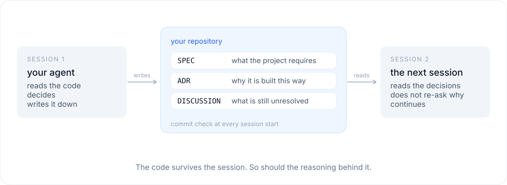

# sddio

**Agent 会忘，仓库不会。**

[English](README.md) · [简体中文](README.zh-CN.md)

[](https://github.com/benxgao/sddio/actions/workflows/ci.yml)


sddio 是给 coding agent 用的 **spec-driven development**，把判断留在 git 里：`SPEC`（项目要求什么）、`ADR`（为什么这么做）、`DISCUSSION`（还有什么没定）、`FLOW`（正在做什么）。判断跟代码放在一起，就能跨会话存活、能在 pull request 里被 review，也不绑定任何一个 agent —— 甚至可以不用 agent。

`v0.1.0` · Node ≥ 18 · MIT · 无账号、无遥测、无服务端

## 快速开始

```bash
npm install --save-dev @sddio/cli
npx sddio init
```

**装一次 → 粘一次 → 提交一次。** `init` 会写好脚手架、把 manifest 已经能证明的 SPEC 条目记下来，最后打印一段提示词。把它粘进你的 agent —— 只生成文件是没用的。

<details>
<summary><b>粘给你的 coding agent</b></summary>

```text
────────────────────────────────────────────────────────────────
Paste this into your coding agent
────────────────────────────────────────────────────────────────

Read `.sddio/context/instructions.md` and follow it.

This project has just been initialised with sddio. Before any other work:

1. Run the commit check in `.sddio/context/instructions/reconciliation.md`.
   `config.json` has no baseline yet, so the state is `unknown`.
2. Check `sddio_workspace/spec/spec_100.md`. Entries ending in a `source:` line
   were recorded mechanically from a manifest field: verify each against its
   source, keep what is accurate, and do not re-derive them from scratch.
3. Bootstrap the workspace as described in `instructions/bootstrap.md`:
   derive the minimum SPEC from the existing code, configuration, tests and
   documentation. Do not ask me for facts the repository already contains.
4. Record at least one DISCUSSION for what the repository cannot settle, so
   the workspace opens with an open question and not only with claims.
5. Report what you recorded, then set `lastProcessedCommit` to `HEAD` and
   `previousCommit` to `HEAD^` in `.sddio/context/config.json`
   (`null` at a root commit).

Then answer this: <your first task>
```

</details>

然后把 `.sddio/` 和 `sddio_workspace/` 跟下一次改动一起提交。



> **已经在用 sddio？** [升级](#升级) · [复制提示词](#可复制片段) · [目录结构](#目录结构) · [版本记录](https://github.com/benxgao/sddio/releases)

## 仓库里会多出什么

```text
.sddio/                  # context 层，归 CLI 所有 —— 升级时整体替换
sddio_workspace/         # 项目知识，归你和你的 agent 所有
  spec/  adr/  discussions/  flow/
AGENTS.md                # 追加一段 sddio 片段，原有内容保留
```

`init` 不往项目外写任何东西，不碰 agent 的配置目录，也不执行任何 git 操作。唯一留给你的一步是提交这两个目录。

## 这个仓库自己就在用 sddio

不是演示目录：这个 CLI 背后的需求、取舍和未决问题，就在你会得到的同一套结构里。

- [`SPEC-011`](sddio_workspace/spec/spec_100.md) —— `init` 必须以 agent 的下一步收尾，而不是以文件清单收尾
- [`ADR-005`](sddio_workspace/adr/adr_100.md) —— 为什么随包发布的 context 是构建产物，包括被否决的那条路
- [`DISC-023`](sddio_workspace/discussions/discussions_100.md) —— 一个 0 字节的 `package.json` 让所有 `npm` 命令失败

每一条都只解决过一次某个决定，而且没有一条能从代码里重新推导出来 —— 这正是它们的价值。

## 知识放在哪里

|                    | 聊天记录 | 一个 docs 目录 | sddio                      |
| ------------------ | -------- | -------------- | -------------------------- |
| 换一个会话还在     | 不在     | 在             | 在                         |
| 代码变了会跟着变   | 不会     | 靠人记得       | 每次会话开始跟 `HEAD` 核对 |
| 落地前能被 review  | 不能     | 能             | 能 —— 它就是一次 diff      |
| 记录「还没定的事」 | 不记     | 很少           | 一等公民（`DISCUSSION`）   |
| 绑定某个 agent     | 是       | 否             | 否                         |

## 它不做什么

- 它不写代码。它记录的是你的 agent 本来要重新推导一遍的那些决定。
- 它不做检索。条目就是纯 Markdown，`grep` 就是查询语言。
- 它自己不强制任何事。一条规则的力量等于读它的那个 agent —— 除非有一个 check 能让它失败。

## 团队怎么用

一个人跑 `init` 并提交结果。此后每个改动需求或取舍的 pull request，都会把这个改动作为 diff 带上来，reviewer 可以对着理由提出反对，而不只是对着代码。下一台电脑上的 agent 从同一份文件开始。

不需要准备任何东西：无账号、无服务端、无遥测，一个 devDependency，MIT。

## 升级

```bash
npm install --save-dev @sddio/cli@latest
npx sddio init
```

`.sddio/` 会被替换，`sddio_workspace/` 永远不动。**升级会把 reconciliation 游标重置为 `null`**，所以下一个会话没有基线：把 `init` 打印的 reconcile 提示词粘进去，让 agent 核对一次现有条目。跳过这一步，工作区会停在 `unknown`，之后每个会话都要从零复核。

## 可复制片段

`init` 可能打印的另一段提示词，留给以后粘贴用。它必须与 `lib/prompt.ts` 保持一致，`test/prompt.test.mjs` 会断言这一点。

<details>
<summary><b>升级后的对账提示词</b></summary>

```text
Read `.sddio/context/instructions.md` and follow it.

The sddio context layer in `.sddio/` was just refreshed by a package upgrade,
and `config.json` now carries no baseline (`null`). Before any other work, run
the commit check and reconcile: `.sddio/context/instructions/reconciliation.md`.

The cursor state is `unknown`, so there is no range to diff: verify the existing
artifacts against the current implementation. Do not rescan unrelated areas, and
do not rewrite artifacts that are still accurate.

Report what you understood and what you changed, then set `lastProcessedCommit`
to `HEAD` and `previousCommit` to `HEAD^` in `.sddio/context/config.json`
(`null` at a root commit), so the next session resumes from a baseline.

Then answer this: <your first task>
```

</details>

## 目录结构

| 路径               | 归属           | 规则                                                                                |
| ------------------ | -------------- | ----------------------------------------------------------------------------------- |
| `.sddio/`          | CLI            | context 层：instructions、schema、routes。`init` 时刷新，所以升级能带上新的 context |
| `sddio_workspace/` | 你和你的 agent | `spec/`、`adr/`、`discussions/`、`flow/`。永不被覆盖                                |

每次会话都从一次提交检查开始：`.sddio/context/config.json` 里的游标与 `HEAD` 比较，只对移动过的那段做对账。见 `.sddio/context/instructions/reconciliation.md`。

## Agent skill

支持 skill 的 agent 可以拿一段短路由，而不必先读 `AGENTS.md`：`npx sddio skill --print` 把它输出到 stdout，不写任何文件。项目里也留了一份 `.sddio/skill/SKILL.md`，可以手动复制。见 [`packages/cli/README.md`](packages/cli/README.md#agent-skill)。

## 给 agent 看

如果有人把这个仓库交给你：

- 入口是 `.sddio/context/instructions.md`。`AGENTS.md` 是规范注册点，不是第二份规则。
- 不要改 `.sddio/`，它归包所有。项目知识在 `sddio_workspace/`。
- `grep -rn "^## " sddio_workspace/*/` 列出所有条目。读命中位置前后约 25 行，不要整篇读。
- 每次会话都先执行 `.sddio/context/instructions/reconciliation.md` 里的提交检查，再做别的。

## 文档

- [`packages/cli/README.md`](packages/cli/README.md) —— 命令、参数、会往项目里放什么
- [`packages/cli/TESTING.md`](packages/cli/TESTING.md) —— 本地验证打包产物
- [`sddio_workspace/spec/spec_100.md`](sddio_workspace/spec/spec_100.md) —— 这个项目对自己的要求
- [`sddio_workspace/adr/adr_100.md`](sddio_workspace/adr/adr_100.md) —— 为什么这么建
- [`sddio_workspace/discussions/discussions_100.md`](sddio_workspace/discussions/discussions_100.md) —— 还没定的事
