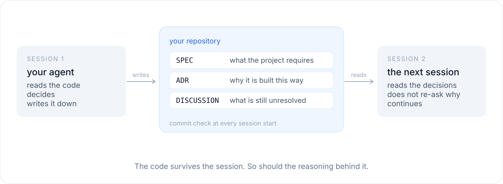

# @sddio/cli

**Spec-driven development for coding agents, kept in your repo.**

`sddio` writes a context layer and a workspace into a project, then hands your agent the first instruction it needs. All of it is plain Markdown committed with your code: what the project requires (`SPEC`), why it's built this way (`ADR`), what's still unresolved (`DISCUSSION`), and what's being worked on (`FLOW`).

[Repository](https://github.com/benxgao/sddio) · [FAQ](https://github.com/benxgao/sddio/blob/master/docs/faq.md) · [How it works](https://github.com/benxgao/sddio#readme) · Node ≥ 18 · MIT



## Install

```bash
npm install --save-dev @sddio/cli
npx sddio init
```

Then **paste the prompt `init` prints** into your coding agent. That step is what turns an empty scaffold into project knowledge. The files on their own do nothing.

```text
────────────────────────────────────────────────────────────────
Paste this into your coding agent
────────────────────────────────────────────────────────────────

Read `.sddio/context/instructions.md` and follow it.

This project has just been initialised with sddio. Before any other work:

1. Run the commit check in `.sddio/context/instructions/reconciliation.md`.
   `config.json` has no baseline yet, so the state is `unknown`.
2. Bootstrap the workspace as described in `instructions/bootstrap.md`:
   derive the minimum SPEC from the existing code, configuration, tests and
   documentation. Do not ask me for facts the repository already contains.
3. Record at least one DISCUSSION for what the repository cannot settle, so
   the workspace opens with an open question and not only with claims.
4. Report what you recorded, then set `reconcileCursor.lastProcessedCommit` to
   `HEAD` and `reconcileCursor.previousCommit` to `HEAD^` in
   `.sddio/context/config.json` (`null` at a root commit).

Then answer this: <your first task>
```

Finally, commit `.sddio/` and `sddio_workspace/` together with your next change. That's the whole install. `init` writes nothing outside the project, doesn't touch an agent's config directory, and runs no git command.

## What `init` prints

| Situation | Prompt | Why |
| --------- | ------ | --- |
| First run, files created | bootstrap | the workspace is empty; the agent derives the first SPEC and records the first open question |
| Only `.sddio/` changed | reconcile | package upgrade; existing knowledge may now be stale |
| Nothing changed | none | already up to date |
| `--dry-run` | none | nothing was written, so there is nothing to hand over |

## Upgrading

```bash
npm install --save-dev @sddio/cli@latest
npx sddio init
```

`.sddio/` is refreshed in place, and `sddio_workspace/` is left alone. `init` then prints the reconcile prompt, so paste it in and let the agent update only the artefacts the upgrade affects. An upgrade resets the reconciliation cursor to `null`, so this step isn't optional. Without it the workspace stays `unknown` and every session re-checks from scratch.

One field survives the refresh: the `hooks` array in `.sddio/context/config.json`. An upgrade must not silently re-wire the project to a caller it abandoned, so `init` keeps the declared hooks and only replaces the rest of the file.

## Commands

```text
sddio init [--dir <path>] [--hook <name>] [--no-install] [--yes] [--force] [--dry-run]
sddio skill --print
```

| Command / flag | Effect |
| -------------- | ------ |
| `init` | Create `.sddio/`, `sddio_workspace/` and the seed collections; register `AGENTS.md`; ask which hook to use; print the next step |
| `skill --print` | Print the agent skill to stdout. Writes nothing |
| `--dir <path>` | Target project root (default: current directory) |
| `--hook <name>` | `flow-trail` (default) or `none`. Naming one installs it unless `--no-install` is given |
| `--no-install` | Declare the hook in `config.json` without running its installer |
| `--yes` | Take the default hook without asking, and install it |
| `--force` | Overwrite existing files, including `sddio_workspace/` seeds |
| `--dry-run` | Report what would change without writing |

With a terminal attached, `init` asks one question: which hook should keep the workspace current. The default is `flow-trail`, and choosing it runs flow-trail's own bootstrap in the target project — a card board in `flow-trail/`, a pointer in `AGENTS.md`. `--yes` gives the same answer without the question, so a script that wants the default spells it `--yes`; `--no-install` is the CI escape when the fetch must not happen. A project that has already answered is not asked again, and an upgrade never re-downloads the hook.

`.sddio/` belongs to the package and gets refreshed on init. `sddio_workspace/` is yours and is only touched with `--force`. A run that finds everything up to date reports all files as skipped.

`--force` resets the workspace seeds to empty files — it is meant for re-initialising a project, not for merging.

## What lands in a project

```text
.sddio/                      # context layer, identical to the sddio repository's own .sddio/
  context/…                  # instructions, schema, routes, principles, preferences, roadmap
sddio_workspace/             # the user's workspace: layout only, empty seeds
  spec/spec_100.md           #   → 0 bytes
  adr/adr_100.md             #   → 0 bytes
  discussions/discussions_100.md
AGENTS.md                    # sddio snippet appended, existing content preserved
```

The workspace ships no starter prose on purpose. It belongs to your project, and placeholder text would be rewritten immediately anyway. See ADR-005 in the sddio repository.

## Agent skill

Agents that support skills can discover sddio without reading `AGENTS.md` first. `skill --print` writes the skill to stdout and nothing else; hints go to stderr, so it can be redirected straight into a skills directory:

```bash
# your agent's skills directory — the CLI neither knows nor guesses it
SKILLS_DIR="$HOME/.config/your-agent/skills"

mkdir -p "$SKILLS_DIR/sddio"
npx sddio skill --print > "$SKILLS_DIR/sddio/SKILL.md"
```

The skill is a router, not a copy of the rules. It names the paths, the invariants and the `grep` that lists entries, then hands the detail to `.sddio/context/instructions.md`, so an upgraded context layer doesn't invalidate it.

The CLI never scans or writes agent configuration directories, and never edits files outside the project. `init` also leaves the file at `.sddio/skill/SKILL.md`, so you can copy it without running anything.

## Requirements

- Node ≥ 18. No Python, no global install.
- git optional: without a repository — or without the git binary — the commit check is skipped and the cursor is left untouched.

## Questions

**Does it need a specific agent?** No. `init` writes `AGENTS.md` and nothing else agent-specific; any agent that reads repository files works, and the prompt it prints is plain text. `skill --print` exists for agents that support skills.

**Does it send anything anywhere?** No account, no server, no telemetry, no update check. It reads and writes files inside the target directory and runs no git command.

**What does it not do?** It does not write code, search or index the workspace, or enforce its rules — there is no `check` command, so a workspace that drifts cannot fail CI. Entries are Markdown; `grep` is the query language.

See [`docs/faq.md`](https://github.com/benxgao/sddio/blob/master/docs/faq.md) for the rest.

## Development

```bash
npm install
npm run build      # regenerates templates/.sddio, then compiles
npm test
npm pack
```

`templates/` is a build artefact, not source. `npm run sync` (run automatically by `build` and `pack`) recreates `templates/.sddio` from this repository's root `.sddio/`, which is the single source of truth. That way the shipped context can't drift from the one this repo dogfoods. The directory is git-ignored. The workspace layout lives in `lib/workspace.ts`.

The prompts printed by `init` live in `lib/prompt.ts`. The copies in this README and in the repository README are asserted against it by `test/prompt.test.mjs`, so they can't drift.

See `TESTING.md` for testing the packed tarball in another local project.
